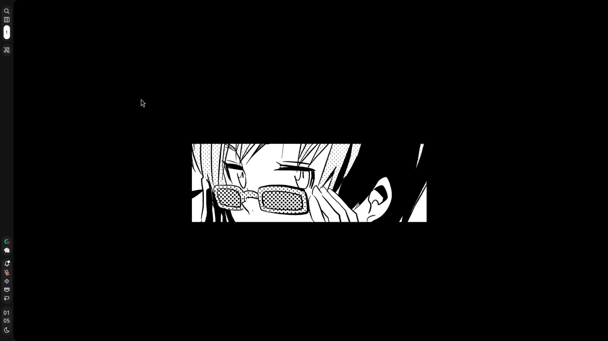

<p align="center">
  
</p>
<h3 align="center">T O M O E &ensp;巴</h3>

<p align="center"><em>Monochrome Chie Satonaka — Persona 4</em></p>
<p align="center">CachyOS dotfiles with Umbriel and Noctalia.</p>

# How to install

```sh
git clone https://github.com/alex-s1508/tomoe.git
cd tomoe
./tomoe install
```

Installs Umbriel + Noctalia (greeter); other setup files are in `dotfiles/`. Configures greetd; backups and logs in `~/.local/state/tomoe/`.

Commands:
```sh
# Install or reinstall Tomoe
./tomoe install [--dry-run] [--yes] [--reboot]

# Update all modules or only selected ones
./tomoe update [--all|--umbriel|--noctalia|--fastfetch|--chrome|--greetd|--monitors]

# List, show, or hide helper desktop apps
./tomoe hidden-apps [--list|--show|--hide]
```

## Keybinds

| Keybind | Action |
|---|---|
| `Mod+Return` | Terminal (kitty) |
| `Mod+B` | Browser |
| `Mod+E` | Files (Nautilus) |
| `Mod+N` | VSCode |
| `Mod+Space` | Launcher |
| `Mod+S` / `Mod+Ctrl+S` | Scratchpad / send window |
| `Mod+Shift+S` | Screenshot |
| `Mod+Tab` | Overview |
| `Mod+F` | Maximize |

## Screenshots

<p align="center">
  
</p>
